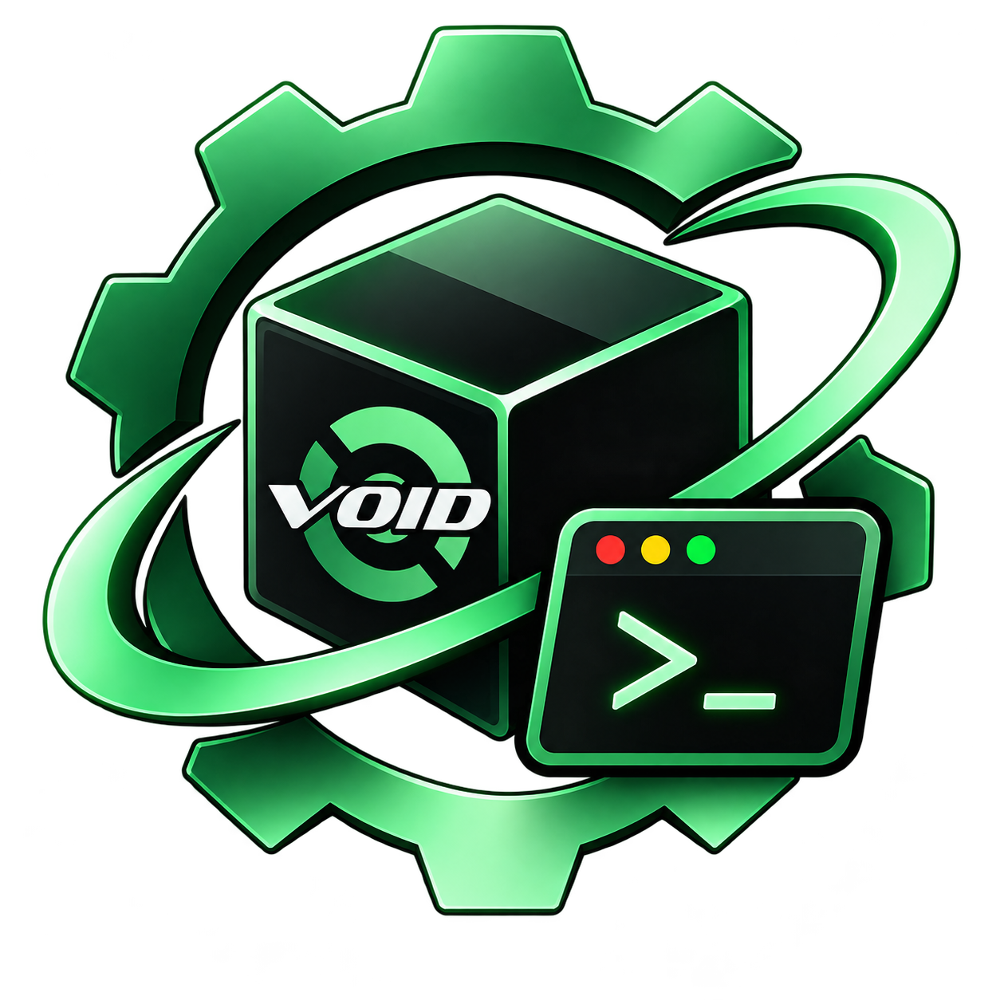

  

VoidForge

A package development workshop for Void Linux, built for the terminal.

A native Rust TUI that brings package development, builds, diagnostics and repository management into one workspace.

  
  
  
  

"Rust" · "Ratatui" · "Crossterm" · "SQLite" · "xbps-src"

Stable 1.0.0

---

<strong>01. About VoidForge</strong>
I started VoidForge because package development on Void Linux often means switching between editors, terminals, build logs and Git commands.

I wanted a more organized place to bring these workflows together without getting in the way of the tools that actually do the work.

VoidForge works directly with your local "void-packages" repository. It reads real templates, executes official "xbps-src" commands, captures build output and helps investigate failures.

It is not a simulator. There is no fake build output, no dashboard server and no pretend package operations.

Everything is connected to real files and real tools on your system.

<strong>02. My Vision</strong>
More Than a GUI for xbps-src

I don't want VoidForge to become just another interface for "xbps-src".

My long term goal is to turn it into an Integrated Package Development Environment for Void Linux, where developers can manage the entire package development lifecycle, from writing the first template to building, testing, maintaining packages and preparing pull requests.

These capabilities will be introduced gradually in future releases.

I also don't want to sacrifice simplicity or performance just to add more features. VoidForge should remain fast, lightweight and intuitive, staying true to the philosophy of Void Linux.

More capability, without unnecessary complexity.

<strong>03. Development Notebook</strong> <code>Living Project Journal</code>
This is where I keep track of VoidForge's development.

I want this section to feel more like a personal engineering notebook than a traditional changelog. It documents what I have added, what I have fixed, what problems I have encountered and what I want to work on next.

The notebook is updated as the project evolves.

Recent Improvements

 Current implemented capabilities
These are part of the current project functionality.

1. Real package template inspection and validation.
2. Official "xbps-src" build execution.
3. Live build output and persistent build logs.
4. Package and workspace management.
5. Dependency inspection and cycle detection.
6. Patch creation, application and backup based recovery.
7. Build diagnostics based on actual log evidence.
8. Git repository operations.
9. Release archive inspection and repository indexing.

 Resolved problems
No new fixes have been recorded here yet.

I only move an issue into this section after the fix has been implemented and verified.

Entry format:

Date: YYYY-MM-DD
Problem: What was wrong?
Fix: What changed?
Verification: How was it tested?

Problems Found

 TUI scrolling limitations
Problem

Some lists and text panels do not have proper independent scrolling behavior.

Long templates, patch previews, Git diffs and diagnostic details can become difficult to inspect when their content exceeds the available terminal space.

Planned fix

Introduce persistent scroll state, proper stateful lists and reliable viewport handling.

Status: Open

 Limited mouse interaction
Problem

The current event handling does not provide complete mouse support. Navigation and interaction primarily depend on keyboard input.

Planned fix

Introduce mouse capture, click handling, panel focus and contextual mouse wheel scrolling.

Status: Open

 Build log navigation
Problem

Long and wrapped build output can be difficult to navigate. There is no complete independent manual scrolling and follow tail experience.

Planned fix

Introduce persistent log offsets, automatic follow tail behavior, manual scrolling and a clear indicator for the current scrolling mode.

Status: Open

Planned Features

 Future development
These are part of my long term vision. They are not available features yet.

1. Complete mouse interaction throughout the TUI.
2. A more advanced Package Studio.
3. Improved template editing and inspection.
4. Smarter Build Center and log navigation.
5. More advanced package diagnostics.
6. Better dependency analysis.
7. More complete Git workflows.
8. Integrated package testing and validation.
9. Tools for preparing and reviewing pull requests.

I don't want to rush these features. Each one should fit naturally into the existing workflow and keep the application lightweight.

How I Maintain This Notebook

Every meaningful change should have a record.

Green means something was added or fixed and verified.

Red means a problem has been identified and still needs attention.

Blue means something I want to build in a future release.

I want this notebook to reflect the actual state of the project, not just make it look more complete than it is.

<strong>04. Current Features</strong>
Package Management

1. Browse and filter real "srcpkgs" templates.
2. Create, duplicate and rename packages.
3. Inspect package variables and subpackage functions.
4. Run static template validation.
5. Open templates in an external editor.

Dependencies

1. Inspect "depends".
2. Inspect "makedepends".
3. Inspect "hostmakedepends".
4. Inspect "checkdepends".
5. Detect dependency cycles.

Patch Management

1. List and preview patches.
2. Create new patches.
3. Generate patches from Git changes.
4. Apply and revert patches with backup protection.

Build Center

1. Execute official "xbps-src" phases.
2. Configure parallel build jobs.
3. Stream actual build output.
4. Cancel active builds.
5. Maintain build history and timestamped logs.
6. Inspect generated package archives.

Diagnostics

1. Analyze actual build logs.
2. Identify errors and warnings.
3. Connect findings to relevant log lines.
4. Inspect template and workspace validation results.

Git Integration

1. Inspect repository status and diffs.
2. Stage and unstage files.
3. Commit changes.
4. Manage branches, tags and remotes.
5. Fetch, pull and push with confirmation.

Workspace Management

1. Register multiple repositories.
2. Clone and switch between workspaces.
3. Validate workspace configuration.
4. Refresh repository information.

<strong>05. Requirements</strong>
Supported platform: Void Linux x86_64 with glibc.

Requirements:

1. Rust and Cargo 1.89 or newer.
2. A local "void-packages" checkout.
3. "xbps-src", "xbps", "xbps-query" and "xbps-rindex".
4. "git", "patch", "curl", "tar", "bash" and "ninja".

Install prerequisites:

sudo xbps-install -S rust git curl tar bash patch ninja xbps xbps-src

Clone the official package repository:

git clone https://github.com/void-linux/void-packages.git ~/void-packages

<strong>06. Installation</strong>
Clone the repository:

git clone https://github.com/anomalogist/voidforge.git
cd voidforge

Build and run:

cargo build --release
./target/release/voidforge

Optional system installation:

sudo install -Dm755 target/release/voidforge /usr/local/bin/voidforge

Run:

voidforge

For development:

cargo run

Important: Run VoidForge as your normal user. Never run the application itself with "sudo". Package builds should remain unprivileged.

<strong>07. Getting Started</strong>
Register a workspace

:workspace add ~/void-packages

You can also clone a repository directly:

:workspace clone https://github.com/void-linux/void-packages.git void-packages

Validate your environment

:workspace validate

Browse packages

Open Packages, filter by name and select a template.

Build a package

:build pkg hello

Investigate a failed build

:diagnose last

Review changes

:git status
:git diff
:git stage srcpkgs/hello/template
:git commit "hello: update to 1.1"

<strong>08. Screens and Navigation</strong>
Key| Screen| Purpose
"1"| Dashboard| System information and activity
"2"| Workspaces| Repository management
"3"| Packages| Package browser
"4"| Template| Template inspection
"5"| Dependencies| Dependency analysis
"6"| Patches| Patch management
"7"| Build Center| Build execution and logs
"8"| Diagnostics| Error investigation
"9"| Git & Repos| Git operations
"0"| Settings| Application configuration

Keyboard shortcuts

Key| Action
"Tab" / "Shift+Tab"| Switch screens
"j" / "k"| Move selection
Arrow keys| Navigate
"Home" / "End"| First / last item
"Enter"| Confirm or open
"Esc"| Close or go back
":"| Command interface
"/"| Package filtering
"?"| Help
"q"| Quit
"Ctrl+C"| Exit

<strong>09. Command Reference</strong>
Workspaces

:workspace add <path>
:workspace clone <url> [name]
:workspace use <name>
:workspace validate
:workspace refresh
:workspace remove <name>

Packages and templates

:pkg list
:pkg new <name>
:pkg duplicate <source> <target>
:pkg rename <old> <new>
:pkg open <name>
:template validate
:template edit

Dependencies and patches

:deps cycles
:patch list
:patch new <name>.patch
:patch from-git <name>.patch <file>
:patch apply <name>.patch
:patch revert <name>.patch
:patch remove <name>.patch

Sources and builds

:source verify
:source download [index]
:source extract [filename]
:source github <url>
:build <phase> [package]
:build cancel
:build logs [index]

Diagnostics and releases

:diagnose last
:diagnose <build-id>
:release list
:release index
:release info <name>

Git

:git status
:git diff
:git stage <path>
:git unstage <path>
:git commit <message>
:git branch
:git branch-new <name>
:git checkout <branch>
:git fetch [remote]
:git pull [remote] [branch]
:git push [remote] [branch]
:git tag

General

:theme dark|light
:jobs <1-64>
:editor <command>
:view <screen>
:help
:clear
:quit

<strong>10. Storage</strong>
Location| Contents
"~/.local/share/voidforge/voidforge.sqlite3"| Settings, workspace index and history
"~/.local/share/voidforge/logs/"| Timestamped build logs
"$XDG_DATA_HOME/voidforge/"| Alternative XDG data location
Your "void-packages" directory| Templates, patches, sources and build artifacts

Removing a workspace entry does not delete the repository from disk.

<strong>11. Safety and Limitations</strong>
1. VoidForge currently targets Void Linux x86_64 with glibc.
2. Builds use the real local "xbps-src" toolchain.
3. Static validation cannot guarantee build success.
4. Git commands use argument arrays rather than shell generated commands.
5. Remote Git operations require confirmation.
6. Patch operations use validation and backups.
7. Workspace operations are designed to preserve user files.
8. Network operations use bounded timeouts.

<strong>12. Troubleshooting</strong>
VoidForge says "not a terminal".

Run it inside a terminal emulator with a real TTY.

No packages appear.

Check the active workspace and verify that "srcpkgs" exists.

:workspace validate

Required tools are missing.

Install them with "xbps-install" and refresh the workspace.

A build fails.

Inspect the original log and diagnostic results.

:build logs
:diagnose last

The terminal looks incorrect after an unexpected exit.

reset

<strong>13. Development and Testing</strong>
Run the project checks:

cargo fmt --all -- --check
cargo check --all-targets
cargo test --all-targets
cargo clippy --all-targets -- -D warnings
cargo build --release

Contributions, bug reports and suggestions are welcome.

When reporting an issue, please include your Void Linux version, the steps to reproduce it and the relevant output.

<strong>14. License</strong>
VoidForge is released under the MIT License.

See "LICENSE" (LICENSE).

Built for Void Linux. Written in Rust. Designed for the terminal.

An independent community project, not an official Void Linux project.

